<p align="center">
  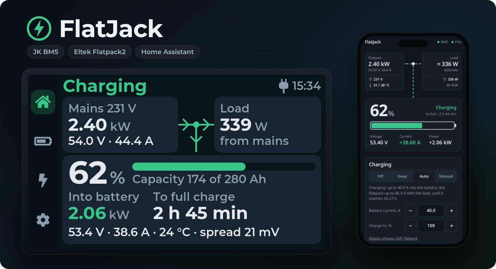
</p>

<h3 align="center">A smart charger for your home battery<br>Розумне заряджання домашньої батареї</h3>

<p align="center">
FlatJack turns an <b>Eltek Flatpack2</b> rectifier and a <b>JK BMS</b> into a charger that knows your battery,<br>with a touch screen on the wall and a web page on your phone. No cloud, no app, no subscription.
</p>
<p align="center">
FlatJack робить із випрямляча <b>Eltek Flatpack2</b> та <b>BMS JK</b> зарядний пристрій, що знає вашу батарею:<br>сенсорний екран на стіні й сторінка на телефоні. Без хмари, без застосунку, без підписки.
</p>

<p align="center">
  <a href="#versions--версії"></a>
  
  
  
</p>

<p align="center">
  <b><a href="#english">English</a></b> &nbsp;·&nbsp; <b><a href="#українська">Українська</a></b> &nbsp;·&nbsp; <b><a href="#versions--версії">⬇️ Download / Завантажити 1.3.0</a></b> &nbsp;·&nbsp; <b><a href="MANUAL.md">📖 Manual</a> / <a href="MANUAL.uk.md">Посібник</a></b> &nbsp;·&nbsp; <a href="LICENSE.md">Licence / Ліцензія</a>
</p>

---

## English

**FlatJack** reads your **JK-PB BMS** and tells an **Eltek Flatpack2** exactly how to charge the battery. It runs on a Waveshare 5-inch touch board that already has Wi-Fi, Bluetooth, RS485 and CAN on it.

### What it does

<table>
<tr>
<td width="33%" valign="top"><b>🔋 Charges it right</b><br>Follows your BMS the way a good inverter does: its stages, its voltages, its timer. Set them once in the JK app.</td>
<td width="33%" valign="top"><b>🌙 Ready for outages</b><br>Shows how long the battery will last without mains, learned from your own home's usage.</td>
<td width="33%" valign="top"><b>📱 On the wall and in your pocket</b><br>A bright 5" touch screen, and a web page on any phone or computer at home. No app, no account.</td>
</tr>
<tr>
<td valign="top"><b>⛽ Generator friendly</b><br>Caps the Flatpack's power and raises it gently, so a small generator copes.</td>
<td valign="top"><b>🏠 Home Assistant</b><br>Enter your MQTT broker once and FlatJack appears there by itself: values, energy counters, controls.</td>
<td valign="top"><b>🔄 Updates from the screen</b><br>A button on the screen finds the newest version and installs it. Free to use, in Ukrainian, English and Russian.</td>
</tr>
</table>

### 📟 On the wall

<p align="center">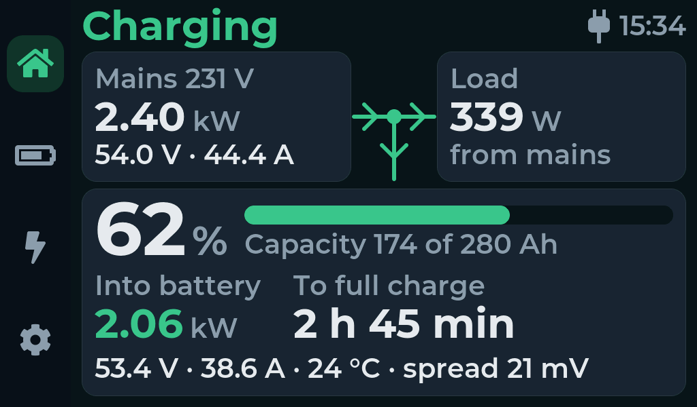</p>

Big numbers you can read at a glance: where the power comes from and where it goes, the charge level, the time to full or to empty, every cell, the day's charge history. Charging modes, the charge limit and the generator's power are a tap away; a QR code opens the web page on your phone.

### 📱 In your pocket

<p align="center">
  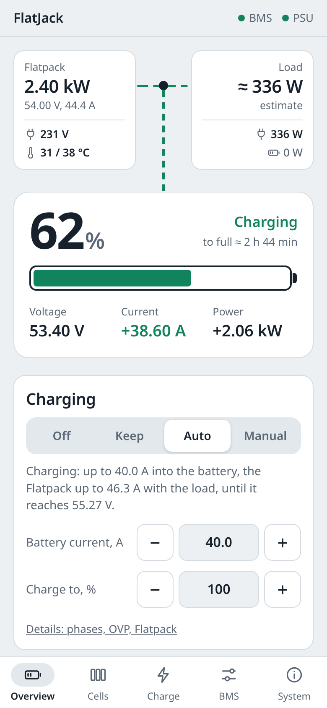
  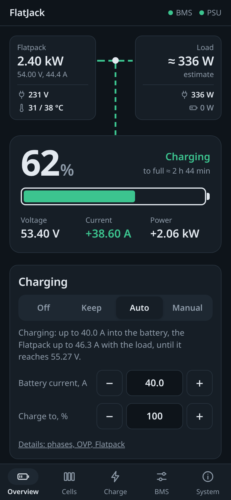
  
</p>

Open **http://flatjack.local** on a phone or a computer: the same live values, the charging controls, every BMS setting, and what the charger is doing right now and why, in plain words. Light or dark, as your phone is set.

### 📈 Every cell, every day

<p align="center">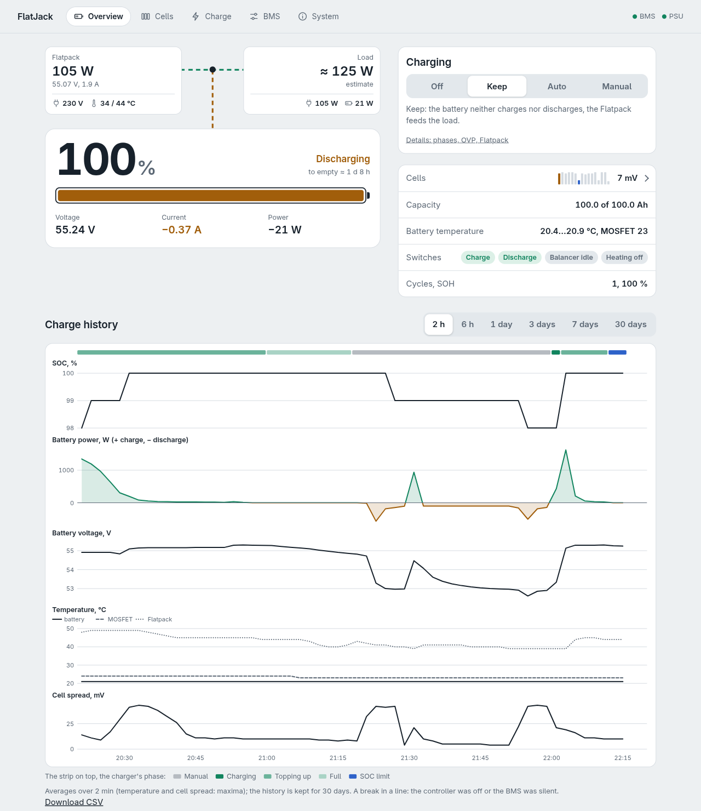</p>
<p align="center">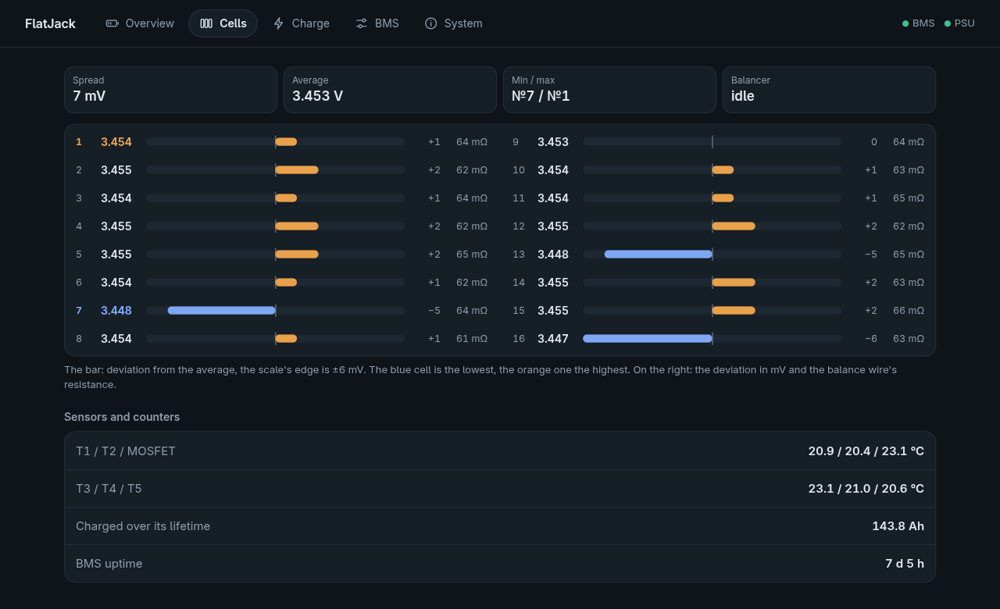</p>

Charts of the charge level, power, voltage, temperatures and cell spread, from 2 hours to 30 days; every cell with its balance wire; energy counters in kWh; the history as a CSV file.

**Also:** a charge limit (keep the battery at 70 % and let the Flatpack feed the house) · up to 4 batteries in parallel · Bluetooth instead of the cable (or as a spare: see Bluetooth below) · a log of the charger's decisions · the BMS settings, with checks that refuse a value that makes no sense.

<sub>The screen and the phone above show a demonstration charge; the charts and the cells are a real evening.</sub>

### 🛡️ When something goes wrong

- **The BMS stays in charge of safety.** Its own protections (cell over-voltage, temperature, current) work as always; FlatJack only drives the charger.
- **If the BMS goes silent**, or its settings look wrong, Auto and Keep end the charge and set the Flatpack to the float voltage (RFV), so the house stays fed. Manual is yours: FlatJack keeps the voltage and current you set.
- **If the board itself stops**, the Flatpack goes on its own, within about 15 seconds, to a fallback voltage FlatJack gave it in advance, with no current limit: the float voltage in Auto and Keep, your voltage in Manual, and one that charges nothing in Off or while a generator limit is set.
- **No cloud.** Charging, the screen and the web page work on your home network alone; the internet only sets the clock (for the charts) and brings updates.

### How it fits together


The Flatpack, the battery (through its BMS) and the inverter share the 48 V wires. FlatJack only talks to them: RS485 to the BMS, CAN to the Flatpack, Wi-Fi to your phone. The board takes its power from the 48 V through the isolated DC-DC.

### What to buy

| What | Notes |
|---|---|
| **Waveshare ESP32-S3-Touch-LCD-5B** | The 5-inch 1024×600 touch board. It already has everything else inside: Wi-Fi, Bluetooth, the RS485 and CAN connections. The 800×480 version (without "B") is not tested. |
| **Isolated DC-DC converter, 48 V → 12 V**, 6 W or more | Powers the board from the battery. **It must be isolated** (input and output not connected), for example Mornsun URB4812YMD-6WR3. The board takes 7–36 V. |
| **JK-PB BMS** (for example JK-PB2A16S20P) | The one with two RJ45 sockets marked RS485-2 / "Parallel". |
| **Eltek Flatpack2 48 V** | With its usual adapter board or connector, where CAN H and CAN L come out. |
| **A network cable (RJ45)** | Cut off one end; it goes from the BMS to the board. |
| **A twisted pair** (one pair of a network cable) and **a 120 Ω resistor** | For CAN, from the board to the Flatpack. The resistor goes at the Flatpack end. |
| **A USB-C cable** | Only for the first flash. |

### 🚀 Set it up in three steps

1. **Put the firmware on the board** from your browser: a minute or two, nothing to install ([below](#put-the-firmware-on-the-board-once)).
2. **Connect four wires and the power:** RS485 to the BMS, CAN to the Flatpack, 12 V from the isolated DC-DC ([below](#wiring)).
3. **Join your Wi-Fi and choose Auto.** The battery and the Flatpack are found by themselves ([below](#first-start)).

Everything else, with screenshots (BMS settings, charging details, generator, several batteries, Bluetooth, Home Assistant, ESPHome, troubleshooting): **[the full manual](MANUAL.md)**.

### Wiring

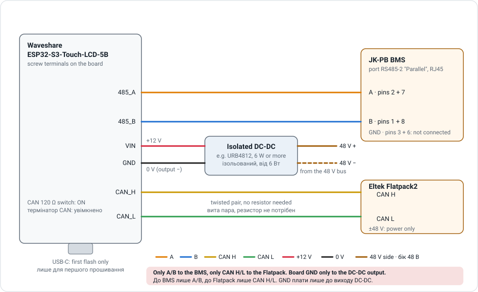

1. **BMS → board (RS485):** in the network cable, twist together the wires of pins 2 and 7 (orange and white-brown in a usual T568B cable) and connect them to `485_A`; pins 1 and 8 (white-orange and brown) go to `485_B`. Leave pins 3 and 6 unconnected. Plug the cable into one of the BMS's **RS485-2** sockets, the pair with no CAN socket next to them.
2. **Flatpack → board (CAN):** CAN H to `CAN_H`, CAN L to `CAN_L`, through one twisted pair. Put the 120 Ω resistor across CAN H and CAN L at the Flatpack end, and switch on the board's own CAN terminator (a small switch on the board).
3. **Power:** the DC-DC's input to the 48 V bus (+ and −), its output to the board's `VIN` (+12 V) and `GND`.

> [!WARNING]
> Nothing else connects the board to the battery or the Flatpack: **no ground wire**. The board's `GND` goes only to the DC-DC's output. The BMS switches the battery's minus, so with its switches off the battery's B− and the BMS's P− are about 50 V apart; a ground through the board would burn its connections.

**On the BMS** (once, in the JK app or with its DIP switches):
- set the **DIP address to 1–15** (not 0), and a different one on each battery;
- if the board never finds the battery, set the protocol of UART1 to **001 – JK BMS RS485 Modbus** in the JK app.

### Put the firmware on the board (once)

You need the file **`flatjack-v1.3.0-waveshare-s3-full.bin`** ([download](v1.3.0/flatjack-v1.3.0-waveshare-s3-full.bin)) and a computer with Windows, macOS or Linux.

**The easy way, in a browser (Windows, macOS, Linux):**

1. Use **Chrome** or **Edge** (Firefox and Safari can't talk to USB devices). On Linux, Chrome or Chromium.
2. Connect the board to the computer with the USB-C cable. If the board has two USB-C sockets, use the one marked **USB**.
3. Open **https://espressif.github.io/esptool-js/** and press **Connect**. Choose the port that appears when you plug the board in (on Windows it is called something like "USB JTAG/serial debug unit (COM5)").
4. Under **Flash Address** type `0x0`, choose the `…-waveshare-s3-full.bin` file and press **Program**. It takes a minute or two.
5. When it says it is done, press the board's **RESET** button (or unplug and plug the cable back in).

<details><summary>No port appears, or Connect fails; the command-line way</summary>

- **Windows 10/11 and macOS** need no driver for this board. Try another cable: many USB-C cables only charge.
- **Linux:** allow yourself to use serial ports, then log out and in again: `sudo usermod -aG dialout $USER` (Arch: `uucp` instead of `dialout`).
- Put the board into flashing mode by hand: hold **BOOT**, press and release **RESET**, release **BOOT**, then press Connect again.

**The command-line way** (any system with Python): `pip install esptool`, then

```sh
esptool.py --chip esp32s3 write_flash 0x0 flatjack-v1.3.0-waveshare-s3-full.bin
```

</details>

### First start

1. The screen shows the FlatJack logo, then its home screen.
2. **Wi-Fi:** the first time, the board opens its own Wi-Fi network `FlatJack-XXXXXX` for 3 minutes. Connect your phone to it: a page opens (if not, open http://192.168.4.1). Choose your home Wi-Fi, type its password and save. The board restarts and joins your network. Later you can change the network on the screen: **Settings → Wi-Fi → Change**.
3. **The web page:** open **http://flatjack.local/**, or the address shown at the bottom of the screen's settings tab (the gear icon) (some Android phones and older Windows don't know `.local` names). **Settings → Wi-Fi → QR code** shows a code your phone camera can open.
4. **The battery and the Flatpack** are found by themselves: the battery within about a minute and a half, the Flatpack within seconds.
5. **Charging:** on the screen's charging tab (the lightning icon on the left) choose **Auto**. The charge voltages come from the BMS settings (RCV, RFV and their times), so check those in the JK app first. **Charge to** sets a limit, **Battery current** the charging current.
6. **Language:** the three flags at the bottom of the **Settings** tab, or on the web page's System tab.

**Charging modes:** **Off** – the Flatpack gives nothing, the battery feeds the house. **Keep** – the Flatpack feeds the house and the battery stays as it is. **Auto** – charges the battery by the BMS settings. **Manual** – you set the Flatpack's voltage and current yourself.

### Bluetooth (optional)

On the web page: **System → Bluetooth → Find a BMS nearby**, then **Add**. Do it while the BMS's cable works, and with the JK phone app closed (the BMS takes one Bluetooth connection at a time). If the cable then stops answering, FlatJack is meant to switch to Bluetooth within seconds and keep charging (new: this switch-over has not been tested on a board yet). Over Bluetooth it only reads; settings are changed over the cable.

### Updates

- **From the screen:** **Settings → the download button beside the version.** It shows what is new and installs it. Needs internet.
- **From the web page:** **System → Firmware update**, choose **`flatjack-vX.Y.Z-waveshare-s3.bin`** (the file *without* `-full`) → Update.

Settings, Wi-Fi and the history are kept. The board restarts after an update, and charging starts again from the beginning.

### If something doesn't work

| Problem | Try |
|---|---|
| "Looking for battery…" for minutes | Swap the `485_A` and `485_B` wires. Check the cable is in an **RS485-2** socket, the DIP address is 1–15, and the UART1 protocol (above). |
| No Flatpack | Swap `CAN_H` and `CAN_L`. Check both 120 Ω terminators and that the Flatpack has mains or battery power. |
| http://flatjack.local/ doesn't open | Use the address from the bottom of the screen's **Settings** tab. |
| The phone app can't connect to the BMS | FlatJack is connected to it over Bluetooth. Remove the device on the web page, or leave it: with a working cable FlatJack lets Bluetooth go. |
| A white glowing frame around the screen | A known fault of Waveshare's board revision 1.1 when the backlight is switched off. Keep **Backlight off too** switched off in Settings. |

> [!NOTE]
> The web page and its settings have no password. Keep the board on your home network; don't open it to the internet.

### Also on an ESP32 DevKit

The same firmware runs on a plain ESP32 DevKit (38 pins) with a MAX485 and an SN65HVD230 module, without a screen: files `flatjack-vX.Y.Z-full.bin` (first flash, at `0x0`, `--chip esp32`) and `flatjack-vX.Y.Z.bin` (updates). Its USB chip needs the Silicon Labs CP210x driver on Windows and macOS. Bluetooth works on it too (1.2.0); during a firmware update over Wi-Fi it is switched off, and the board restarts afterwards (it has too little memory for both).

<details><summary>DevKit wiring</summary>

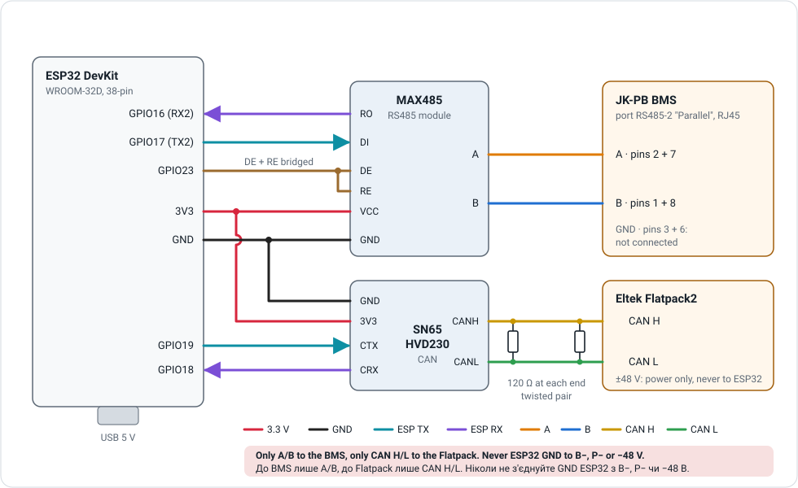


</details>

### Licence

FlatJack's firmware is free to download, install on your own devices and use. Its source code is not published. It comes as is, without warranty. Full text: [LICENSE.md](LICENSE.md); open-source parts inside it: [THIRD-PARTY.md](THIRD-PARTY.md). For the LGPL libraries each version also has a relinking kit (`…-relink.zip`), to build the firmware with your own modified version of them: [RELINK.md](RELINK.md).

---

## Українська

<p align="center">
  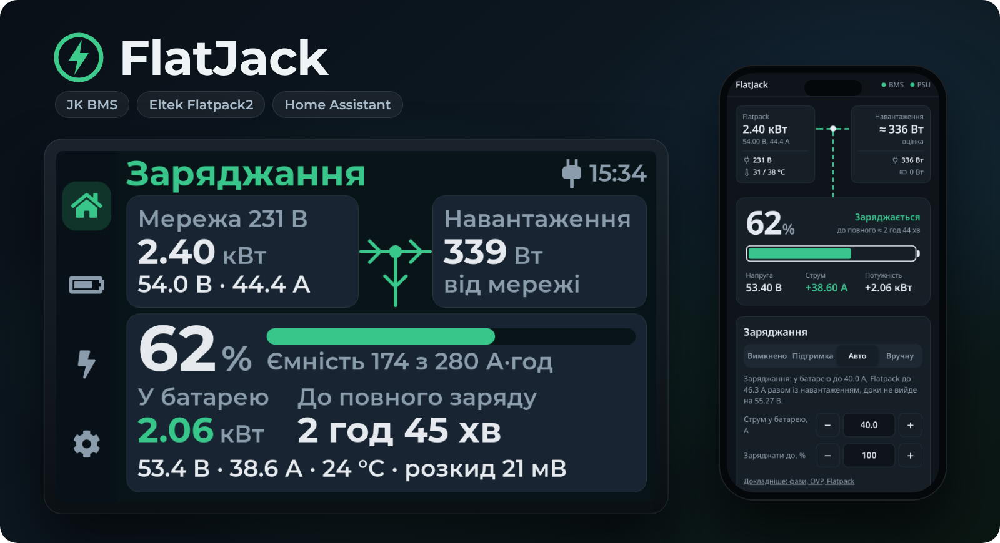
</p>

**FlatJack** читає вашу **BMS JK-PB** і підказує **Eltek Flatpack2**, як саме заряджати батарею. Він працює на сенсорній платі Waveshare 5", де вже є Wi-Fi, Bluetooth, RS485 і CAN.

### Що він робить

<table>
<tr>
<td width="33%" valign="top"><b>🔋 Заряджає правильно</b><br>Виконує стадії, напруги й таймер вашої BMS, як добрий інвертор. Налаштуйте їх один раз у застосунку JK.</td>
<td width="33%" valign="top"><b>🌙 Готовий до відключень</b><br>Показує, на скільки вистачить батареї без мережі, за споживанням саме вашого дому.</td>
<td width="33%" valign="top"><b>📱 На стіні й у кишені</b><br>Яскравий сенсорний екран 5" і сторінка на будь-якому телефоні чи комп'ютері вдома. Без застосунку й облікового запису.</td>
</tr>
<tr>
<td valign="top"><b>⛽ Дружить із генератором</b><br>Обмежує потужність Flatpack і нарощує її плавно, щоб малий генератор витримав.</td>
<td valign="top"><b>🏠 Home Assistant</b><br>Вкажіть свій MQTT-брокер один раз, і FlatJack з'явиться там сам: показники, лічильники енергії, керування.</td>
<td valign="top"><b>🔄 Оновлення з екрана</b><br>Кнопка на екрані знаходить найновішу версію і встановлює її. Безкоштовно, українською, англійською й російською.</td>
</tr>
</table>

### 📟 На стіні

<p align="center">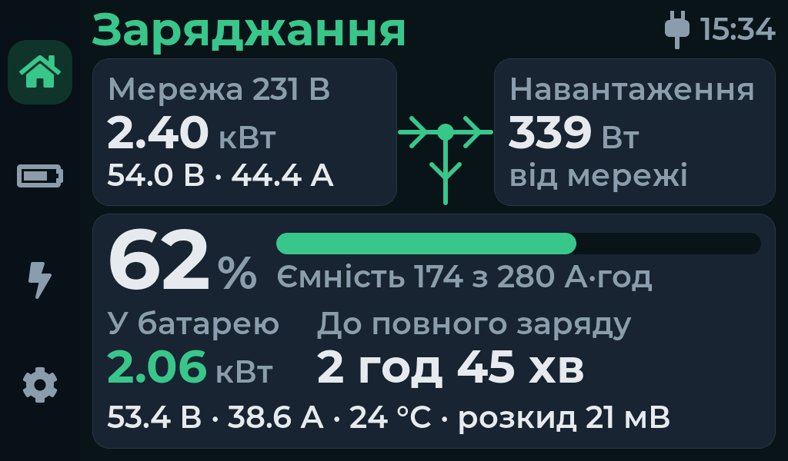</p>

Великі цифри, які видно з першого погляду: звідки береться енергія й куди йде, рівень заряду, скільки до повного чи до порожнього, кожна комірка, історія заряду за день. Режими заряджання, межа заряду й потужність генератора за одне торкання; QR-код відкриває вебсторінку на телефоні.

### 📱 У кишені

<p align="center">
  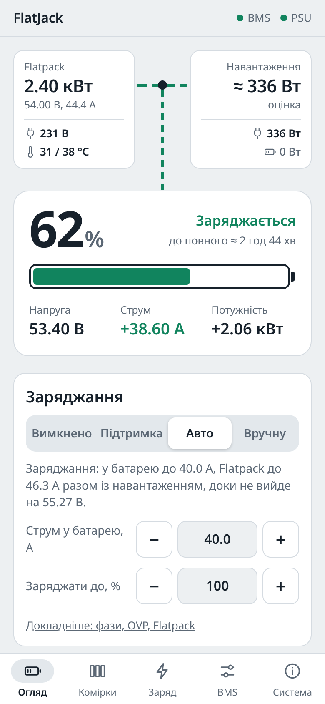
  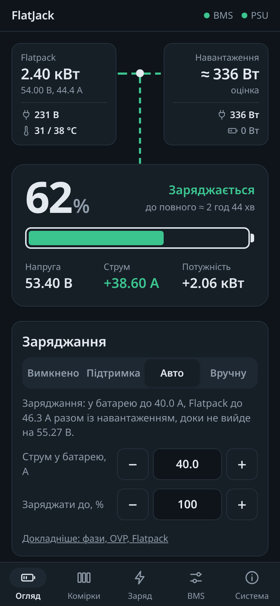
  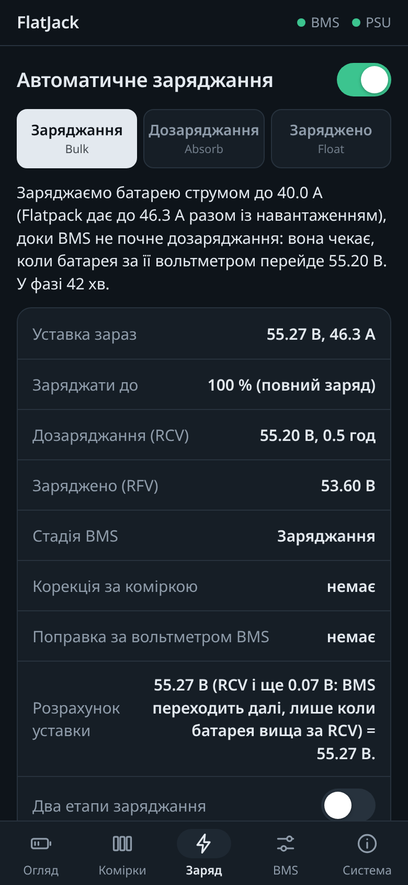
</p>

Відкрийте **http://flatjack.local** на телефоні чи комп'ютері: ті самі живі значення, керування заряджанням, усі налаштування BMS і що зарядний робить саме зараз і чому, звичайними словами. Світла чи темна тема, як на телефоні.

### 📈 Кожна комірка, кожен день

<p align="center">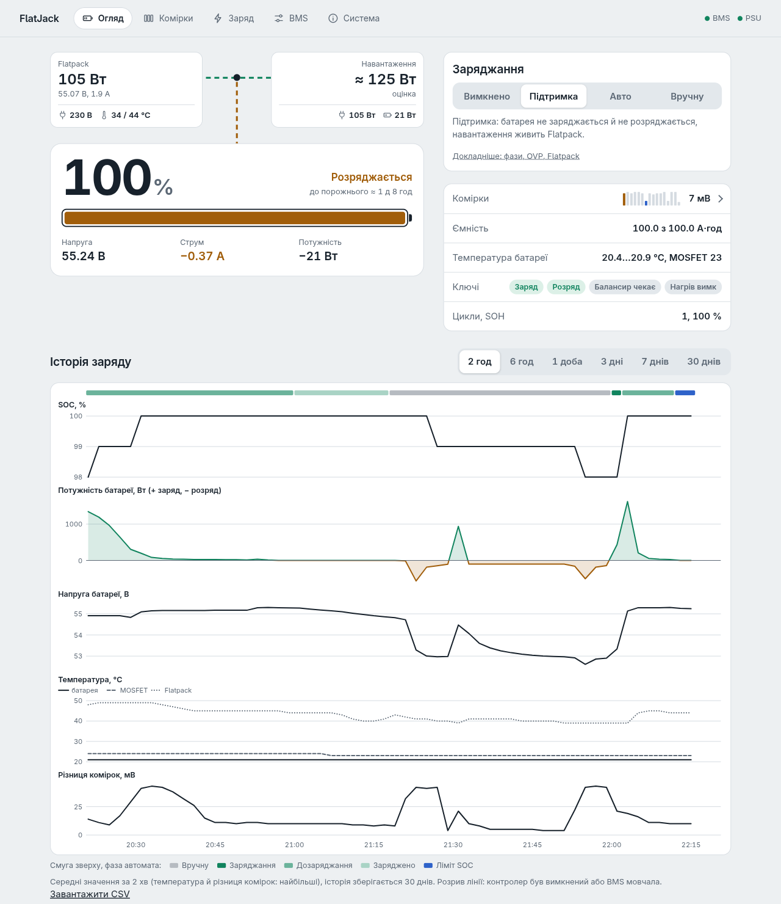</p>
<p align="center">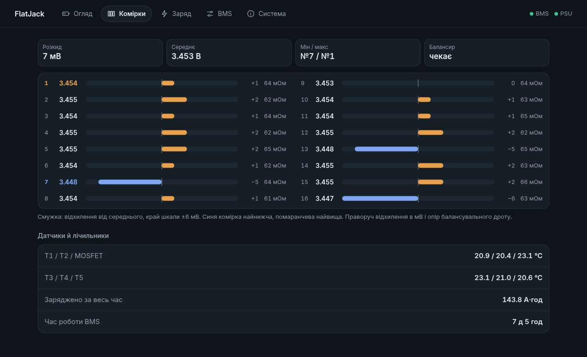</p>

Графіки рівня заряду, потужності, напруги, температур і розкиду комірок, від 2 годин до 30 днів; кожна комірка з її балансувальним дротом; лічильники енергії в кВт·год; історія й файлом CSV.

**А ще:** межа заряду (тримати батарею на 70 %, а дім живити від Flatpack) · до 4 батарей паралельно · Bluetooth замість кабелю (або як запасний: див. Bluetooth нижче) · журнал рішень зарядного · налаштування BMS з перевірками, що не приймуть безглуздого значення.

<sub>Екран і телефон угорі показують демонстраційне заряджання; графіки й комірки взяті зі справжнього вечора.</sub>

### 🛡️ Коли щось іде не так

- **За безпеку й далі відповідає BMS.** Її власні захисти (перенапруга комірок, температура, струм) працюють як завжди; FlatJack лише керує зарядним.
- **Якщо BMS замовкла** або її налаштування виглядають хибними, у режимах «Авто» й «Підтримка» FlatJack припиняє заряджання й виставляє Flatpack на напругу RFV, тож дім живиться далі. Режим «Вручну» ваш: FlatJack тримає задані вами напругу й струм.
- **Якщо зупиниться сама плата**, Flatpack приблизно за 15 секунд сам перейде на запасну напругу, яку FlatJack задав йому заздалегідь, без обмеження струму: RFV у режимах «Авто» й «Підтримка», вашу напругу в режимі «Вручну» і таку, що нічого не заряджає, у режимі «Вимкнено» або поки задане обмеження для генератора.
- **Без хмари.** Заряджання, екран і вебсторінка працюють у домашній мережі; інтернет лише виставляє годинник (для графіків) і приносить оновлення.

### Як це влаштовано


Flatpack, батарея (через свою BMS) та інвертор сидять на одних дротах 48 В. FlatJack лише розмовляє з ними: RS485 із BMS, CAN із Flatpack, Wi-Fi з вашим телефоном. Живлення плата бере з тих самих 48 В через ізольований DC-DC.

### Що купити

| Що | Примітки |
|---|---|
| **Waveshare ESP32-S3-Touch-LCD-5B** | Сенсорна плата 5 дюймів, 1024×600. Усе інше в ній уже є: Wi-Fi, Bluetooth, підключення RS485 і CAN. Версія 800×480 (без «B») не перевірена. |
| **Ізольований DC-DC перетворювач 48 В → 12 В**, від 6 Вт | Живить плату від батареї. **Обов'язково ізольований** (вхід і вихід не з'єднані), наприклад Mornsun URB4812YMD-6WR3. Плата приймає 7–36 В. |
| **BMS JK-PB** (наприклад JK-PB2A16S20P) | Та, що має два гнізда RJ45 з написом RS485-2 / «Parallel». |
| **Eltek Flatpack2 48 В** | Зі звичайною перехідною платою чи роз'ємом, де виведені CAN H і CAN L. |
| **Мережевий кабель (RJ45)** | Один кінець відріжте; він іде від BMS до плати. |
| **Вита пара** (одна пара мережевого кабелю) і **резистор 120 Ом** | Для CAN, від плати до Flatpack. Резистор ставиться біля Flatpack. |
| **Кабель USB-C** | Лише для першого прошивання. |

### 🚀 Три кроки до запуску

1. **Прошийте плату** з браузера: хвилина-дві, нічого не треба встановлювати ([нижче](#прошивка-плати-один-раз)).
2. **Під'єднайте чотири дроти й живлення:** RS485 до BMS, CAN до Flatpack, 12 В від ізольованого DC-DC ([нижче](#підключення)).
3. **Під'єднайте плату до Wi-Fi й виберіть «Авто».** Батарея й Flatpack знайдуться самі ([нижче](#перший-запуск)).

Усе інше, зі знімками (налаштування BMS, подробиці заряджання, генератор, кілька батарей, Bluetooth, Home Assistant, ESPHome, якщо щось не так): **[повний посібник](MANUAL.uk.md)**.

### Підключення


1. **BMS → плата (RS485):** у мережевому кабелі скрутіть разом дроти контактів 2 і 7 (помаранчевий і біло-коричневий у звичайному кабелі T568B) і під'єднайте до `485_A`; контакти 1 і 8 (біло-помаранчевий і коричневий) до `485_B`. Контакти 3 і 6 лишіть вільними. Кабель вставте в одне з гнізд **RS485-2** на BMS, ту пару, біля якої немає гнізда CAN.
2. **Flatpack → плата (CAN):** CAN H до `CAN_H`, CAN L до `CAN_L`, однією витою парою. Резистор 120 Ом поставте між CAN H і CAN L біля Flatpack, а на платі увімкніть її власний термінатор CAN (маленький перемикач на платі).
3. **Живлення:** вхід DC-DC до шини 48 В (+ і −), вихід до `VIN` (+12 В) і `GND` плати.

> [!WARNING]
> Більше нічого не з'єднує плату з батареєю чи Flatpack: **жодного дроту землі**. `GND` плати йде лише до виходу DC-DC. BMS комутує мінус батареї, тож коли її ключі вимкнені, між B− батареї та P− BMS близько 50 В; земля через плату спалила б її підключення.

**На BMS** (один раз, у застосунку JK або DIP-перемикачами):
- **DIP-адреса 1–15** (не 0), у кожної батареї своя;
- якщо плата так і не знаходить батарею, у застосунку JK виставте протокол UART1 **001 – JK BMS RS485 Modbus**.

### Прошивка плати (один раз)

Потрібен файл **`flatjack-v1.3.0-waveshare-s3-full.bin`** ([завантажити](v1.3.0/flatjack-v1.3.0-waveshare-s3-full.bin)) і комп'ютер з Windows, macOS або Linux.

**Найпростіше, у браузері (Windows, macOS, Linux):**

1. Відкрийте **Chrome** або **Edge** (Firefox і Safari не вміють працювати з USB-пристроями). На Linux: Chrome або Chromium.
2. Під'єднайте плату до комп'ютера кабелем USB-C. Якщо на платі два гнізда USB-C, беріть те, що підписане **USB**.
3. Відкрийте **https://espressif.github.io/esptool-js/** і натисніть **Connect**. Виберіть порт, що з'являється, коли ви під'єднуєте плату (у Windows він називається приблизно «USB JTAG/serial debug unit (COM5)»).
4. У полі **Flash Address** введіть `0x0`, виберіть файл `…-waveshare-s3-full.bin` і натисніть **Program**. Це займає хвилину-дві.
5. Коли напише, що готово, натисніть на платі кнопку **RESET** (або висмикніть і знову вставте кабель).

<details><summary>Порт не з'являється або Connect не вдається; через командний рядок</summary>

- **Windows 10/11 і macOS** не потребують драйвера для цієї плати. Спробуйте інший кабель: багато кабелів USB-C лише заряджають.
- **Linux:** дозвольте собі доступ до послідовних портів і перезайдіть у систему: `sudo usermod -aG dialout $USER` (Arch: `uucp` замість `dialout`).
- Переведіть плату в режим прошивання вручну: затисніть **BOOT**, натисніть і відпустіть **RESET**, відпустіть **BOOT**, тоді знову Connect.

**Через командний рядок** (будь-яка система з Python): `pip install esptool`, далі

```sh
esptool.py --chip esp32s3 write_flash 0x0 flatjack-v1.3.0-waveshare-s3-full.bin
```

</details>

### Перший запуск

1. На екрані з'являється логотип FlatJack, потім головний екран.
2. **Wi-Fi:** уперше плата на 3 хвилини відкриває власну мережу Wi-Fi `FlatJack-XXXXXX`. Під'єднайте до неї телефон: відкриється сторінка (якщо ні, відкрийте http://192.168.4.1). Виберіть свою домашню мережу, введіть пароль і збережіть. Плата перезапуститься й під'єднається до вашої мережі. Пізніше мережу можна змінити на екрані: **Налаштування → Wi-Fi → Змінити**.
3. **Вебсторінка:** відкрийте **http://flatjack.local/** або адресу внизу вкладки налаштувань на екрані (значок шестірні) (деякі телефони Android і старі Windows не знають імен `.local`). **Налаштування → Wi-Fi → QR-код** показує код, який відкриє камера телефона.
4. **Батарея й Flatpack** знаходяться самі: батарея приблизно за півтори хвилини, Flatpack за секунди.
5. **Заряджання:** на вкладці заряджання на екрані (значок блискавки ліворуч) виберіть **Авто**. Напруги заряджання беруться з налаштувань BMS (RCV, RFV і їхні часи), тож спершу перевірте їх у застосунку JK. **Заряджати до** задає межу, **Струм у батарею** струм заряджання.
6. **Мова:** три прапорці внизу вкладки **Налаштування** або вкладка «Система» на вебсторінці.

**Режими заряджання:** **Вимкнено** – Flatpack нічого не дає, дім живить батарея. **Підтримка** – дім живить Flatpack, а батарея лишається як є. **Авто** – заряджає батарею за налаштуваннями BMS. **Вручну** – напругу й струм Flatpack задаєте ви.

### Bluetooth (за бажанням)

На вебсторінці: **Система → Bluetooth → Знайти BMS поруч**, потім **Додати**. Робіть це, поки кабель BMS працює, і закрийте застосунок JK на телефоні (BMS приймає одне Bluetooth-з'єднання за раз). Якщо потім кабель перестане відповідати, FlatJack має за кілька секунд перейти на Bluetooth і заряджати далі (нове: цей перехід на платі ще не перевірений). Через Bluetooth він лише читає; налаштування змінюються через кабель.

### Оновлення

- **З екрана:** **Налаштування → кнопка завантаження біля версії.** Покаже, що нового, і встановить. Потрібен інтернет.
- **З вебсторінки:** **Система → Оновлення прошивки**, виберіть **`flatjack-vX.Y.Z-waveshare-s3.bin`** (файл *без* `-full`) → «Оновити».

Налаштування, Wi-Fi та історія зберігаються. Після оновлення плата перезапускається, і заряджання починається спочатку.

### Якщо щось не працює

| Що | Що спробувати |
|---|---|
| «Пошук батареї…» кілька хвилин | Поміняйте місцями дроти `485_A` і `485_B`. Перевірте, що кабель у гнізді **RS485-2**, DIP-адреса 1–15 і протокол UART1 (вище). |
| Немає Flatpack | Поміняйте місцями `CAN_H` і `CAN_L`. Перевірте обидва термінатори 120 Ом і що Flatpack має живлення від мережі чи батареї. |
| http://flatjack.local/ не відкривається | Відкрийте адресу знизу вкладки **Налаштування** на екрані. |
| Застосунок JK не під'єднується до BMS | До неї під'єднаний FlatJack через Bluetooth. Видаліть пристрій на вебсторінці або лишіть як є: коли кабель працює, FlatJack відпускає Bluetooth. |
| Біла світла рамка по краях екрана | Відома вада плати Waveshare ревізії 1.1, коли вимикається підсвітка. Не вмикайте в налаштуваннях **Вимикати й підсвітку**. |

> [!NOTE]
> Вебсторінка та її налаштування без пароля. Тримайте плату в домашній мережі, не відкривайте її в інтернет.

### Також на ESP32 DevKit

Та сама прошивка працює на звичайній ESP32 DevKit (38 контактів) з модулями MAX485 і SN65HVD230, без екрана: файли `flatjack-vX.Y.Z-full.bin` (перше прошивання, з `0x0`, `--chip esp32`) і `flatjack-vX.Y.Z.bin` (оновлення). Її USB-мікросхемі у Windows і macOS потрібен драйвер Silicon Labs CP210x. Bluetooth на ній теж працює (1.2.0); під час оновлення прошивки через Wi-Fi він вимикається, а плата потім перезапускається (пам'яті на обидва не вистачає).

<details><summary>Підключення DevKit</summary>


</details>

### Ліцензія

Прошивку FlatJack можна вільно завантажувати, встановлювати на свої пристрої й використовувати. Вихідний код не публікується. Постачається як є, без гарантій. Повний текст: [LICENSE.md](LICENSE.md); відкриті компоненти всередині: [THIRD-PARTY.md](THIRD-PARTY.md). Для бібліотек під LGPL у кожній версії є ще набір для перезбирання (`…-relink.zip`), щоб зібрати прошивку з власною зміненою версією цих бібліотек: [RELINK.md](RELINK.md).

---

## Versions / Версії

### 1.3.0

- Charging follows the JK BMS's own stage, as an inverter does
- New switch on the web page: two-stage charge
- ESP32 DevKit: fewer restarts with the web page open

- Заряд веде власна стадія BMS JK, як в інвертора
- Новий перемикач на вебсторінці: два етапи заряджання
- ESP32 DevKit: менше перезапусків з відкритою вебсторінкою

| | Update / Оновлення | First flash over USB / Перше прошивання через USB |
|---|---|---|
| Waveshare ESP32-S3-Touch-LCD-5B | [flatjack-v1.3.0-waveshare-s3.bin](v1.3.0/flatjack-v1.3.0-waveshare-s3.bin) | [flatjack-v1.3.0-waveshare-s3-full.bin](v1.3.0/flatjack-v1.3.0-waveshare-s3-full.bin) |
| ESP32 DevKit | [flatjack-v1.3.0.bin](v1.3.0/flatjack-v1.3.0.bin) | [flatjack-v1.3.0-full.bin](v1.3.0/flatjack-v1.3.0-full.bin) |

### 1.2.1

- Fixes from a code review: Flatpack, charging, BMS, Bluetooth
- Home Assistant: an empty message no longer clears the power cap
- Screen: + and − reach 4000 W and 62.5 A, as on the web page

- Виправлення після огляду коду: Flatpack, заряд, BMS, Bluetooth
- Home Assistant: порожнє повідомлення не знімає ліміт потужності
- Екран: + і − доходять до 4000 Вт і 62,5 А, як на вебсторінці

| | Update / Оновлення | First flash over USB / Перше прошивання через USB |
|---|---|---|
| Waveshare ESP32-S3-Touch-LCD-5B | [flatjack-v1.2.1-waveshare-s3.bin](v1.2.1/flatjack-v1.2.1-waveshare-s3.bin) | [flatjack-v1.2.1-waveshare-s3-full.bin](v1.2.1/flatjack-v1.2.1-waveshare-s3-full.bin) |
| ESP32 DevKit | [flatjack-v1.2.1.bin](v1.2.1/flatjack-v1.2.1.bin) | [flatjack-v1.2.1-full.bin](v1.2.1/flatjack-v1.2.1-full.bin) |

### 1.2.0

- Energy: kWh through the Flatpack and the battery, by day
- ESP32 DevKit: Bluetooth link to the BMS

- Енергія: кВт·год через Flatpack і батарею, по днях і всього
- ESP32 DevKit: зв'язок із BMS через Bluetooth

| | Update / Оновлення | First flash over USB / Перше прошивання через USB |
|---|---|---|
| Waveshare ESP32-S3-Touch-LCD-5B | [flatjack-v1.2.0-waveshare-s3.bin](v1.2.0/flatjack-v1.2.0-waveshare-s3.bin) | [flatjack-v1.2.0-waveshare-s3-full.bin](v1.2.0/flatjack-v1.2.0-waveshare-s3-full.bin) |
| ESP32 DevKit | [flatjack-v1.2.0.bin](v1.2.0/flatjack-v1.2.0.bin) | [flatjack-v1.2.0-full.bin](v1.2.0/flatjack-v1.2.0-full.bin) |

### 1.1.0

- Charger decision log: what changed and why
- Setpoint breakdown: why this voltage and why no current

- Журнал рішень зарядки: що й чому змінював автомат
- Розрахунок уставки: звідки така напруга й чому немає струму

| | Update / Оновлення | First flash over USB / Перше прошивання через USB |
|---|---|---|
| Waveshare ESP32-S3-Touch-LCD-5B | [flatjack-v1.1.0-waveshare-s3.bin](v1.1.0/flatjack-v1.1.0-waveshare-s3.bin) | [flatjack-v1.1.0-waveshare-s3-full.bin](v1.1.0/flatjack-v1.1.0-waveshare-s3-full.bin) |
| ESP32 DevKit | [flatjack-v1.1.0.bin](v1.1.0/flatjack-v1.1.0.bin) | [flatjack-v1.1.0-full.bin](v1.1.0/flatjack-v1.1.0-full.bin) |

### 1.0.0

- More BMS settings: signals, functions, cell links
- BMS calibration, its clock and restart
- Wire or Bluetooth icon by the clock; a full manual

- Більше налаштувань BMS: сигнали, функції, перемички
- Калібрування BMS, її годинник і перезапуск
- Значок дроту чи Bluetooth біля годинника; повний посібник

| | Update / Оновлення | First flash over USB / Перше прошивання через USB |
|---|---|---|
| Waveshare ESP32-S3-Touch-LCD-5B | [flatjack-v1.0.0-waveshare-s3.bin](v1.0.0/flatjack-v1.0.0-waveshare-s3.bin) | [flatjack-v1.0.0-waveshare-s3-full.bin](v1.0.0/flatjack-v1.0.0-waveshare-s3-full.bin) |
| ESP32 DevKit | [flatjack-v1.0.0.bin](v1.0.0/flatjack-v1.0.0.bin) | [flatjack-v1.0.0-full.bin](v1.0.0/flatjack-v1.0.0-full.bin) |
